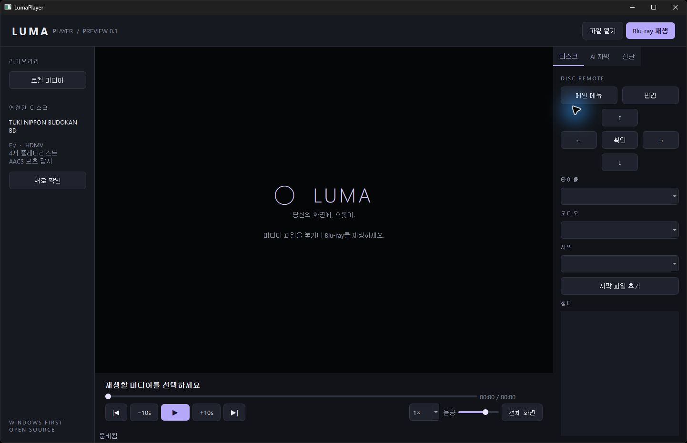

# LumaPlayer

깔끔한 네이티브 UI의 오픈소스 Blu-ray / 미디어 플레이어입니다. **Windows 먼저, Linux 다음** 순서로 개발합니다. 애플리케이션은 C++20과 Qt 6으로 작성하며 Python을 사용하지 않습니다.

> 개발 중인 첫 프리뷰입니다. 팟플레이어 전체 기능과 모든 DRM·Dolby Vision 출력의 완전 지원을 의미하지 않습니다. 구현 상태와 실물 검증 결과를 분리해 공개합니다.

**2026-11-05 실물 검증:** 츠키 디스크의 메뉴 → 본편, 영상·PCM 음성 출력, 29개 챕터, 일시정지·탐색·메뉴 복귀를 확인했습니다. AV1 하드웨어 재생과 로컬 AI 자막도 실제 실행으로 검증했습니다. [검증 기록과 수치](docs/testing/2026-11-05-windows.md).



## 실행

[GitHub Releases](https://github.com/mk0000001/luma-player/releases)에서 Windows x64 ZIP을 받아 전체 폴더를 풀고 `LumaPlayer.exe`를 실행하세요. 실행 파일만 분리하면 재생 엔진을 찾을 수 없습니다. 첫 프리뷰에는 로컬 음성인식 모델을 함께 제공합니다.

- **Blu-ray 재생**: 연결된 디스크를 열고, 디스크 자체 메뉴 또는 오른쪽 리모컨으로 조작합니다.
- **파일 열기 / 드래그 앤 드롭**: libmpv 엔진으로 미디어를 재생합니다.
- **AI 자막**: AI 자막 탭에서 음성 언어를 선택하고 켭니다. 원어를 인식하며, 생성 결과를 SRT로 저장할 수 있습니다. 한국어 번역은 별도 개발 항목입니다.
- Space: 재생/일시정지. Ctrl+O: 파일. Ctrl+D: 디스크. F11: 전체 화면. Esc: 전체 화면 해제. Shift+←/→: 10초 탐색. 디스크 영상에 포커스가 있으면 방향키/Enter로 메뉴를 조작합니다.

## 보호된 디스크

libbluray/libaacs/libbdplus를 연결합니다. AACS 라이브러리는 Windows에서 플레이어 EXE와 같은 폴더에도 배치해야 합니다. 라이브러리 설치만으로 모든 상용 디스크의 접근 정보가 생기지는 않습니다. 필요한 로컬 설정은 사용자 환경에 별도로 있어야 하며 **키·인증서·상용 디스크 내용은 소스나 배포 파일에 포함하지 않습니다.**

이 프로젝트의 첫 합격 기준은 `TUKI_NIPPON_BUDOKAN_BD` 실물 디스크의 메뉴와 본편 재생입니다. 자세한 결과는 [실물 테스트 기록](docs/testing/2026-11-05-windows.md)에 기록합니다. 다른 디스크 전체에 대한 보장은 아닙니다.

## 개발

Windows: Visual Studio 2022 C++ Build Tools, Windows SDK, CMake 3.25+, Ninja, PowerShell 7이 필요합니다.

```powershell
git clone https://github.com/mk0000001/luma-player.git
cd luma-player
pwsh -File scripts/bootstrap-windows.ps1
pwsh -File scripts/build-windows.ps1
pwsh -File scripts/stage-runtime.ps1
.\.deps\qt\bin\windeployqt.exe --release --no-translations build\LumaPlayer.exe
.\build\LumaPlayer.exe
```

의존성 URL과 SHA-256은 [dependencies.lock.json](dependencies.lock.json)에 고정합니다. bootstrap은 키 데이터베이스를 내려받거나 인증 정보를 생성하지 않습니다.

Linux 개발 빌드(실제 디스크·표시 환경 검증은 후속 단계):

```sh
sudo apt install cmake ninja-build g++ qt6-base-dev libvlc-dev libmpv-dev ffmpeg
cmake -S . -B build -G Ninja -DCMAKE_BUILD_TYPE=Release
cmake --build build
ctest --test-dir build --output-on-failure
./build/LumaPlayer
```

Linux의 초기 영상 임베딩 경로는 X11/XWayland입니다. 네이티브 Wayland/HDR 및 패키징은 별도 검증이 필요합니다. 로컬 AI를 쓰려면 whisper.cpp의 `whisper-cli`와 다국어 GGML 모델이 필요합니다.

## 버전과 기여

모든 배포 버전은 `vMAJOR.MINOR.PATCH[-prerelease]` 태그와 GitHub Release를 가집니다. 이미 공개한 태그와 바이너리는 덮어쓰지 않습니다. 개발 과정은 커밋·PR·테스트 기록으로 남깁니다.

- [기능 대응표와 로드맵](docs/FEATURES.md)
- [변경 기록](CHANGELOG.md)
- [아키텍처 설계](docs/superpowers/specs/2026-11-05-luma-player-design.md)
- [기술 조사](docs/research/engine-decisions.md)
- [구현 결정과 제한](docs/DECISIONS.md)
- [라이선스와 의존성 소스](THIRD_PARTY_NOTICES.md)

GPL-3.0-or-later. 프로젝트 이름과 UI는 독립적으로 작성했으며 팟플레이어의 코드나 자산을 포함하지 않습니다.
